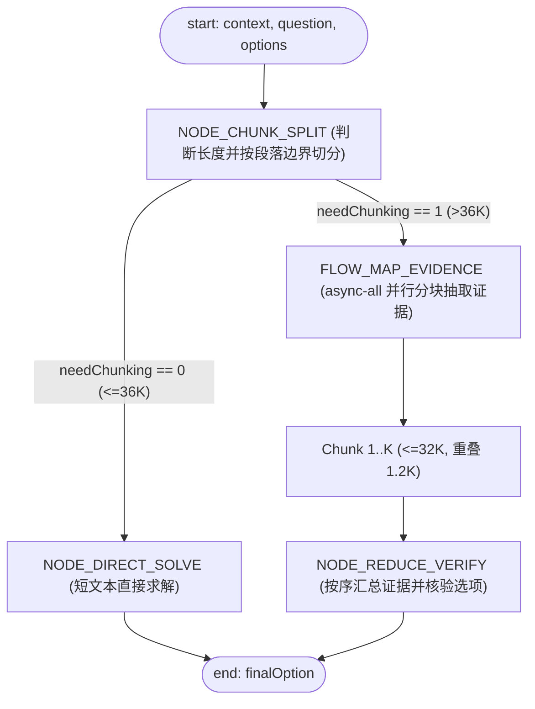

# `rsi-flow` 代码结构梳理

配合本周任务看了一遍 `ymxiong/rsi-flow`（`0.4.14`，Java 1.8 / Spring 5.1.1 / FastJSON 1.2.60）和群里发的 `settings.xml`、`0.1.2.zip`，记一下关键模块和后续怎么把这周的流程接进去。

## 1. 项目里的 7 个模块

- `flow-config`：定义流程图 JSON 对应的数据结构（`FlowConfig`、`FlowNodeConfig`、`FlowRouteConfig`、`FlowRouteStrategyConfig`、`FlowScheduleConfig`）。
- `flow-core`：核心调度引擎 `FlowEngine`、上下文 `FlowContextHolder` 和静态结构检查（依赖 `cn.edu.whu.zhuyuhan:scheduler-core:0.1.2`）。
- `flow-model`：数据模型和字段校验。
- `flow-route`：边上的条件判断与节点流转。
- `flow-remote`：支持节点发远程 HTTP 请求。
- `flow-spring-boot-starter`：Spring Boot 自动装配，扫描 `@Flow` / `@FlowComponent` 注解。
- `flow-test`：自带的 TestNG 测试用例，里面能直接看到各种流程 JSON 的标准写法。

## 2. 编译依赖备忘

- `flow-core/pom.xml` 第 93–96 行引了 `scheduler-core:0.1.2`，群里发的 `0.1.2.zip` 就是这个包，但它的父 POM `scheduler:0.1.2` 和兄弟包 `scheduler-data` 需要连私服（`http://central.horsecoder.com:8081/repository/maven-releases/`）或者用群里给的 `settings.xml`（配好了 `horsecoder-test` 账号和阿里云镜像）。
- 目前这台电脑上只有 JDK 25，还没装 Maven (`mvn`)，所以本周的评测脚本先在 Python 侧跑通，下周补装 Maven 并把 `settings.xml` 放进 `~/.m2/`、把 `0.1.2.zip` 放到本地 `.m2` 仓库再跑 `rsi-flow` 单测。

## 3. 已支持的流程写法

从 `flow-test/src/test/resources/flow/` 里的几个例子看下来，`rsi-flow` 的 JSON 图已经支持：
1. **顺序流**（`flow-standard.json`）：`start -> node -> end`，靠 `params` 和 `results` 传变量。
2. **条件分支**（`flow-condition-simple.json`）：在 `routes` 上写 `"condition": "type==1"`。
3. **子流程嵌套**（`flow-nest.json`）：节点设成 `"type": "flow", "reference": "子流程ID"` 就能套进去。
4. **并行扇出和汇聚**（`flow-asyn-all.json` / `flow-asyn-any.json`）：在 `strategies` 里写 `"strategy": "all"`（或 `"any"`）和 `"strategy": "close"`。

不过对长程 Agent 经常要用的**显式循环（比如直到校验通过才跳出的 while 循环）**，现有测试里还没有现成范式，这也是下周任务 2 可以补的设计点。

## 4. 把 Marathon 分段取证流程写成 `rsi-flow` JSON



对照这周改出来的 Map-Reduce + 校验流程，映射成 `rsi-flow` 的 JSON 大概是这样：

```json
{
  "id": "FLOW_MARATHON_EVIDENCE_SOLVER",
  "type": "flow",
  "name": "长上下文分段取证与校验流程",
  "params": [
    { "name": "context", "type": "String" },
    { "name": "question", "type": "String" },
    { "name": "options", "type": "String" }
  ],
  "results": [
    { "name": "finalOption", "type": "String" }
  ],
  "nodes": [
    {
      "id": "NODE_CHUNK_SPLIT",
      "type": "event",
      "name": "判断长度并切分上下文",
      "reference": "MARATHON_CHUNK_SPLIT",
      "params": [{ "name": "context", "type": "String" }],
      "results": [
        { "name": "chunkList", "type": "String" },
        { "name": "needChunking", "type": "Integer" }
      ]
    },
    {
      "id": "NODE_DIRECT_SOLVE",
      "type": "event",
      "name": "短文本直接求解",
      "reference": "MARATHON_DIRECT_SOLVE",
      "params": [
        { "name": "context", "type": "String" },
        { "name": "question", "type": "String" },
        { "name": "options", "type": "String" }
      ],
      "results": [{ "name": "finalOption", "type": "String" }]
    },
    {
      "id": "FLOW_MAP_EVIDENCE",
      "type": "flow",
      "name": "分块并行提取证据子流程",
      "reference": "SUBFLOW_CHUNK_EVIDENCE",
      "params": [
        { "name": "chunkList", "type": "String" },
        { "name": "question", "type": "String" }
      ],
      "results": [{ "name": "evidenceItems", "type": "String" }]
    },
    {
      "id": "NODE_REDUCE_VERIFY",
      "type": "event",
      "name": "汇总证据与选项核验",
      "reference": "MARATHON_REDUCE_VERIFY",
      "params": [
        { "name": "evidenceItems", "type": "String" },
        { "name": "question", "type": "String" },
        { "name": "options", "type": "String" }
      ],
      "results": [{ "name": "finalOption", "type": "String" }]
    }
  ],
  "routes": [
    { "source": "start", "target": "NODE_CHUNK_SPLIT" },
    { "source": "NODE_CHUNK_SPLIT", "target": "NODE_DIRECT_SOLVE", "condition": "needChunking==0" },
    { "source": "NODE_CHUNK_SPLIT", "target": "FLOW_MAP_EVIDENCE", "condition": "needChunking==1" },
    { "source": "FLOW_MAP_EVIDENCE", "target": "NODE_REDUCE_VERIFY" },
    { "source": "NODE_DIRECT_SOLVE", "target": "end" },
    { "source": "NODE_REDUCE_VERIFY", "target": "end" }
  ]
}
```
